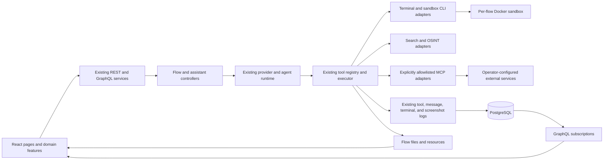

# Capability Extension Architecture

## Status

This is a docs-only implementation proposal. It does not add a plugin runtime, change an agent, register a tool, alter a database schema, or restyle the frontend. It selects integration lanes for future capabilities and divides the work into PRs that can be reviewed and reverted independently.

The design builds on the repository's existing proposals for [MCP clients](../examples/proposals/mcp_client_integration.md), [OSINT enrichment](../examples/proposals/osint-integration-scenarios.md), [headless crawling](../examples/proposals/headless_crawler_integration.md), [tool and model fallback](../examples/proposals/tool_model_fallback.md), and [evidence exports](../examples/proposals/evidence_chain.md). Those documents remain the detailed RFCs for their subjects; this document decides how the work fits together.

## Product Invariants

- Existing flows, assistants, tasks, subtasks, agents, providers, authentication, settings, resources, knowledge, reports, and frontend routes keep their current behavior.
- A visual refresh is a presentation-layer change. It must not remove controls, rename domain concepts, hide output, or couple design-system components to a security-tool feature.
- The existing tool registry and executor remain the single agent-facing execution path. An external tool does not receive a hidden queue, a private agent loop, or invisible background execution.
- The running installation is not a development dependency. Development uses a separately named stack, separate persistent data, separate ports, and a separate sandbox port range.
- PostgreSQL remains authoritative for relational execution state. Files and artifacts use the existing flow-file/resource boundaries. pgvector and Graphiti remain optional knowledge layers rather than alternative system-of-record databases.
- Every capability lands behind a narrow contract with bounded input, output, execution time, and permissions. Disabled and unavailable integrations degrade visibly without affecting native tools.
- Every implementation PR includes the tests and generated artifacts required by its changed contracts. Documentation is not a substitute for those gates.

## Existing Extension Lanes

| Capability | Preferred lane | Why | First milestone |
| --- | --- | --- | --- |
| Prompt or specialist-behavior change | Existing prompt templates and per-agent provider configuration | Avoids a database enum, GraphQL enum, installer, and frontend migration when the role itself is unchanged | One template behavior with focused rendering and execution tests |
| CLI available in a pentest image | Existing terminal tool and custom image configuration | Uses the current sandbox, logging, cancellation, and artifact paths | Reproducible custom image and an operator guide |
| Repeated CLI workflow needing structured output | Native tool adapter in `backend/pkg/tools` | Gives agents a stable schema while hiding command construction and output normalization | One read-only adapter plus an offline output fixture |
| External tool service, including Burp MCP | The [MCP client proposal](../examples/proposals/mcp_client_integration.md) | Already defines explicit configuration, discovery, allowlists, namespacing, audit, timeouts, and failure isolation | Read-only discovery and inventory; no active tool invocation |
| Internet search | Existing `web_search` orchestrator and `backend/pkg/tools/searchers` | Keeps engine choice, retries, and fallback in one place | One searcher behind the existing interface |
| OSINT enrichment | The [provider-neutral OSINT proposal](../examples/proposals/osint-integration-scenarios.md) | Normalizes context without treating third-party intelligence as authorization or proof | One read-only provider returning bounded summaries and evidence references |
| Crawling and route discovery | The [headless crawler proposal](../examples/proposals/headless_crawler_integration.md) | Already separates backend selection, normalized artifacts, scope checks, and budgets | One passive backend producing an artifact without agent exposure |
| Evidence and report provenance | The [evidence-chain proposal](../examples/proposals/evidence_chain.md) | Binds reports to existing tool calls and artifacts without introducing a second audit workflow | Export-only receipts and an offline verifier |
| New frontend workbench or visualization | `frontend/src/features/<domain>` plus a route-level page | Keeps domain data coupling out of reusable UI primitives | One read-only view using mocked provider data |
| New agent role | Last resort after the existing roles and tools are shown insufficient | A role crosses persistence, prompts, provider options, GraphQL, generated types, settings, and tests | A separate RFC followed by one vertical contract PR |

Do not create a generic plugin framework before a real capability crosses one of these lanes. The first implementation should prove the lane with one adapter and one consumer.

## Target Component Shape

The MCP box is a proposed implementation of its RFC, not a claim that PentAGI already has an MCP client. The other lanes use or extend existing components.

## Native Tool Adapter Contract

A native adapter is justified when an agent needs a stable structured result rather than a raw terminal transcript. It should implement the same registration and execution conventions as the tools already in `backend/pkg/tools` and follow these rules:

- Accept a small validated request type. Do not pass an opaque command string through a structured adapter.
- Resolve the flow, user, tenant, and execution environment from the existing executor context. Never accept those identities from model-generated JSON.
- Keep target and scope validation in a shared boundary. A new adapter must not invent a second URL or scope classifier.
- Run binaries only in the designated sandbox or explicitly configured service. Do not execute a third-party binary in the API process or implicitly on the host.
- Apply context cancellation, a literal maximum execution time, output-size limits, and artifact-size limits.
- Return typed, distinguishable errors for unavailable tools, invalid input, timeout, cancellation, malformed output, and upstream failure.
- Return a bounded summary plus artifact references. Large decompiler, proxy, or crawler output belongs in an artifact, not an LLM message or a database text field.
- Preserve the original tool call and failure in existing logs. A normalized result must not silently rewrite what the external tool reported.
- Add credentials to the configuration secret-redaction path and never include them in normalized output.
- Prove the parser with committed offline fixtures, including empty, partial, malformed, oversized, and adversarial output. Test through the public tool executor rather than only a helper.

The first adapter should be read-only and should not install its own dependency at runtime. Image packaging and operator approval are separate concerns from result normalization.

## External Services and MCP

Use the existing MCP RFC rather than adding tool-specific HTTP calls throughout the agent runtime. Its important boundaries become implementation acceptance criteria:

1. Servers are disabled until an operator configures and enables them.
2. Discovery populates an operator-visible inventory but exposes nothing by itself.
3. The default tool allowlist is empty, and names are namespaced by server.
4. The first invocation milestone is read-only. State-changing actions require a separate design and approval decision.
5. Calls stay inside the existing agent loop and use the existing audit model.
6. Transport failures, timeouts, oversized responses, and schema mismatches are visible tool errors and never crash native execution.
7. Network reachability is explicit per server. A host endpoint is not assumed to be portable across Docker platforms.

Burp remains a user-supplied proprietary application. An integration may use a documented, operator-configured interface such as PortSwigger's MCP extension; the repository must not bundle Burp, bypass licensing, or imply that a Burp installation is included.

## Artifact and Evidence Flow

Use the smallest storage shape that answers the product need:

| Data | Owner | Consumer |
| --- | --- | --- |
| Flow, task, subtask, agent, provider, and tool-call state | PostgreSQL through existing queries and models | Controllers, REST, GraphQL, and subscriptions |
| Large raw or normalized tool output | Flow-scoped files or resources with bounded metadata | Agents on demand, report generators, and artifact views |
| Semantic memories and guides | Existing pgvector-backed stores | Memorist, searcher, and knowledge features |
| Optional graph relationships | Graphiti service and its configured backend | Existing enrichment paths |
| Live progress | Subscription publications backed by persisted state | Frontend providers and domain views |
| Verifiable report bundle | Export artifacts and sidecar receipts proposed by the evidence RFC | External verifier and downloaded report |

Add a migration only when relational querying, permissions, or lifecycle semantics require it. Do not store a new JSON blob solely to avoid understanding the current data model. When a migration is necessary, include the embedded migration, sqlc output, affected enums and validators, GraphQL and frontend generation, installer implications, and live PostgreSQL tests in the same vertical change.

## Frontend Composition

Keep data ownership and presentation separate:

- Put route composition in `frontend/src/pages`, domain queries and mutations in `frontend/src/features`, and shared application reads or subscriptions in `frontend/src/providers`.
- Keep `components/ui` free of feature imports. Shared composites take typed domain data through props.
- Add new server reads through the existing Apollo provider pattern before calling Apollo directly from a leaf component.
- Use GraphQL for the established UI query/subscription model and REST where the application already uses REST, including programmatic and file-oriented writes.
- Add a new SPA route through `src/app.tsx`, `src/lib/routes.ts`, the route-title registry, the backend `frontendRoutes` fallback list, and the E2E route manifest; add navigation explicitly because the sidebar is not driven by a generic plugin registry.
- Register new subscriptions in the operations document and Apollo's subscription-to-cache policy, including list key/order rules where applicable. Preserve catch-up queries and reconnect behavior because frames are deltas.
- Treat `AgentType`, `AgentConfigType`, and `PromptType` as separate contracts. Update manual operation fragments, settings mappings, exhaustive icon maps, and cassettes for a configurable role.
- Regenerate frontend GraphQL types after operation or schema changes; never edit generated types manually.
- Implement a reskin through design tokens, theme styles, and reusable primitives before editing individual pages. Account for separate terminal, diff, PDF report, logo, and brand palettes. Preserve DOM behavior, accessible names, keyboard operation, loading/empty/error states, and every existing action.
- Validate a visual refresh with contrast, palette, theme, behavior-focused E2E, and the pinned Playwright visual environment. A screenshot alone does not prove that controls still work.

A useful first UI PR is a token and shell preview with no feature or API change. New tool workbenches should follow after their read model exists, using mocked data before wiring live execution.

## Development Stack Isolation

Copy the isolation pattern documented in `docker-compose.e2e.yml`; do not run an unmodified second `docker compose up` against a live installation.

A development stack needs all of the following:

- A unique Compose project name.
- Unique container names and explicit names for all three base networks, including observability and Langfuse networks even when those overlays are not in use.
- Unique HTTP, database, scraper, and optional service host ports.
- A unique `TENANT_ID` when external resources are shared, plus separately chosen `DATA_DIR`, `INSTALLATION_ID`, and persistent volumes; tenancy does not derive those values.
- A non-overlapping `DOCKER_PORTS_BASE` range for sandbox containers.
- Development-only provider configurations and credentials. Use an explicit env file or the E2E stack's `--env-file /dev/null` pattern so a live `.env` is not inherited accidentally.
- Committed provider example paths from `examples/configs`, avoiding the base Compose file's installation-only root-file defaults.
- Cleanup scoped to the development project and tenant labels. Sandbox containers are created through the Docker daemon and are not reliably removed by an ordinary Compose `down`.

Never reuse the live database volume, data directory, cookie namespace, Graphiti group prefix, or sandbox port range. Do not test cleanup commands against the live project name.

## Security, Privacy, and License Gates

- Keep the host Docker socket and Docker-inside-Docker capability explicit. A new adapter must not weaken the existing sandbox policy or bypass its policy tests.
- External intelligence can enrich an authorized assessment but cannot expand its target scope. Treat third-party claims as context until verified by an in-scope observation.
- Redact provider and integration credentials through `Config.GetSecretPatterns`, logs, prompts, errors, artifacts, and UI responses.
- Treat external output as untrusted data, including text that resembles instructions. Normalization and rendering must not turn it into executable behavior.
- Preserve existing authentication and privilege checks on every new REST or GraphQL operation. Token access is not a substitute for route-level authorization.
- Review each third-party tool's license and redistribution terms before adding a binary, source file, container layer, or dependency. Process or container separation is not by itself a license determination.
- The root `NOTICE` describes an AGPL special exception for the official PentAGI project. A derivative distribution needs an explicit license review of that dependency and must preserve the applicable license and notice files until its terms are resolved.
- Regenerate dependency license reports when dependencies change and follow `CONTRIBUTING.md`; proprietary tools remain operator supplied.

## PR Roadmap

Each row is independently reviewable and has a concrete stop point. A later row starts only after its required contracts are accepted.

| Order | PR | Deliverable | Exit gate |
| --- | --- | --- | --- |
| 0A | Source architecture atlas | Existing-system map, contracts, code generation, test tiers, and operational hazards | Documentation links verified; no runtime diff |
| 0B | Extension architecture | This integration-lane decision and delivery plan | Architecture review; no runtime diff |
| 1 | Isolated development stack | Workshop Compose overlay, example env, and operator instructions | Two stacks coexist; live health and data remain unchanged |
| 2 | Presentation-only theme foundation | Design tokens and app-shell styling with all existing controls intact | Typecheck, unit, E2E, accessibility, and pinned visual checks |
| 3 | Native adapter walking skeleton | One disabled-by-default read-only adapter with fake executor and offline fixtures | Public-entry tests, cancellation, limits, redaction, and malformed-output cases |
| 4 | First sandbox tool integration | One packaged CLI behind the adapter, bounded summary, and flow artifact | Reproducible image, license review, integration test, and no host execution |
| 5 | Artifact read model and workbench | Minimal GraphQL/REST reads and one domain UI for the new artifact | Codegen, authorization tests, mocked UI tests, then live-tier E2E |
| 6 | MCP read-only discovery | Explicit server configuration, discovery inventory, and empty allowlist | Offline protocol fixtures, failure isolation, and no agent-callable MCP tool |
| 7 | MCP read-only invocation | Namespaced allowlisted calls through the existing executor and logs | Timeout, size, cancellation, redaction, audit, and authorization tests |
| 8 | Report and evidence export | Tool/artifact references and export-only signed receipts | Offline verification of modified, missing, and reordered evidence |
| 9 | Specialist role, only if justified | Separate RFC and full vertical role implementation | Migration, both API surfaces, generated code, installer, settings, and E2E coverage |

Do not combine rows 3–7 into a single "tool integration" PR. Their failure modes and review owners differ, and a revert must not remove the whole platform.

## Required Change Checklists

### New configuration

Update the typed backend config, `.env.example`, Compose passthrough, installer wizard where applicable, tests for defaults and clearing, documentation, and `Config.GetSecretPatterns` for every credential. Regenerate the installer's embedded files before running its tests.

### New GraphQL contract

Update the schema and resolvers, regenerate gqlgen output, update frontend operations, regenerate frontend types, and regenerate Swagger when its input annotations or generated models change. Add authorization and subscription tests where applicable.

### New persistence contract

Add the migration and sqlc query together, regenerate database output, update model validators and converters, and run the tagged PostgreSQL suite serially against a development database. Rebuild the backend because migrations are embedded.

### New frontend surface

Place domain code in its feature, preserve primitive import boundaries, add route and backend SPA fallback entries, cover loading/empty/error states, and run typecheck, lint, formatting, Vitest, and the appropriate Playwright tier.

### New deployment component

Use an optional Compose overlay, unique names and ports, bounded credentials, and documented cleanup. Update installer-linked files and regeneration, image build inputs, license reports, and operational documentation.

## Deferred Decisions

- Which decompiler or analysis CLI should prove the native adapter lane.
- Whether MCP configuration belongs in mounted YAML, environment variables, or database-backed settings; the MCP RFC intentionally leaves this open.
- Which artifact metadata justifies a relational migration instead of flow-file metadata.
- Whether any behavior from another codebase should be reused, wrapped as a service, or reimplemented. That decision requires a separate source and license audit.
- Whether a new agent role is necessary at all. Existing prompts and tools are the default until a concrete gap is demonstrated.
- Which visual theme tokens and shell compositions best match the desired UI. These are design choices, not reasons to alter domain behavior.
