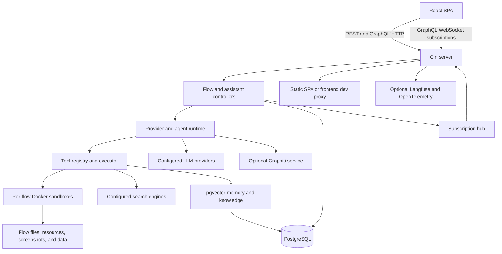
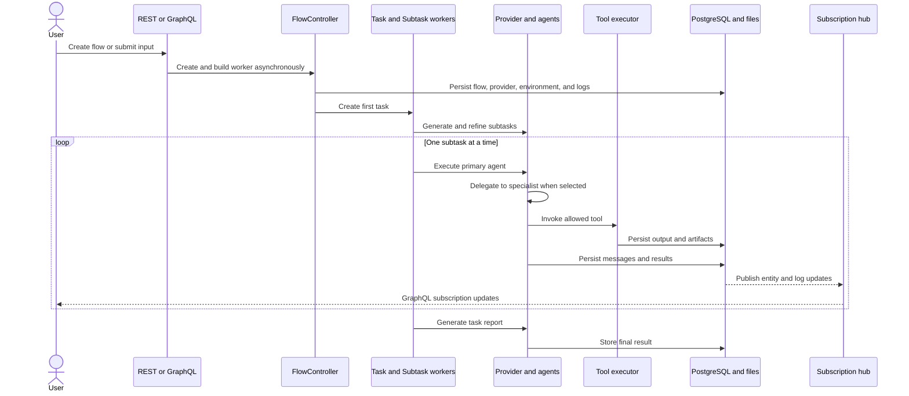

# PentAGI Source Atlas

## Purpose

This atlas is a navigation map for implementation work. It identifies the running components, the contracts that couple them, the authoritative registries, generated-code boundaries, test tiers, and the files most likely to change together. It describes the source at commit `cffed94`; the code remains authoritative when this document and the implementation drift apart.

Start with the system flow, then use the package tables to find a subsystem, then read the linked focused documentation. Do not edit a generated file before finding its generator in the [generation matrix](#generation-matrix).

## Repository Shape

The repository contains 1,728 tracked files: 965 under `backend`, 611 under `frontend`, 98 under `examples`, and the remainder in deployment, observability, CI, scripts, licenses, and root documentation. The principal implementation languages are Go, TypeScript, TSX, SQL, YAML, and Go templates.

| Area | Responsibility | Important boundaries |
| --- | --- | --- |
| [`backend/`](../backend) | Go REST and GraphQL server, agent runtime, tools, providers, persistence, installer, and utility binaries | `cmd` contains entry points; `pkg` contains application packages; `migrations` and `sqlc` feed generated persistence code |
| [`frontend/`](../frontend) | React and TypeScript SPA, domain features, design system, Apollo state, Vitest, and Playwright | `src/graphql/types.ts` is generated; E2E and test tooling live outside `src` |
| [`observability/`](../observability) | OpenTelemetry, Grafana, Loki, Jaeger, ClickHouse, dashboards, and vendored plugin provenance | Optional Compose overlay; installer embeds parts of this tree |
| [`examples/`](../examples) | Provider configurations, guides, prompts, reports, test reports, Graphiti/Neo4j examples, and design RFCs | `examples/proposals` contains designs, not implemented capabilities |
| [`scripts/`](../scripts) | Image build, runtime entrypoint, version, and license helpers | Version rules have Go, shell, PowerShell, Dockerfile, and test-table representations |
| [`.github/`](../.github) | PR/issue templates, CI, E2E workflows, and codegen-change detection | Pull-request CI is fork-safe and does not require deployment secrets |
| Root build and deployment | Multi-stage `Dockerfile`, base Compose file, optional overlays, isolated E2E Compose file, environment template | The base stack is not safe to launch twice with unchanged names and ports |
| Root legal and contributor docs | MIT license, EULA, notices, contribution and dependency-license rules | Dependency and derivative licensing require explicit review |

## System Context

The application is one deployable API/UI image with separate PostgreSQL/pgvector and scraper services in the base Compose stack. Agent commands execute in per-flow sandbox containers, not in the API process. Optional overlays add observability, Langfuse, and Graphiti/Neo4j.

## Startup and Request Flow

[`backend/cmd/pentagi/main.go`](../backend/cmd/pentagi/main.go) is the composition root:

1. Load and validate environment configuration, including the optional tenant identifier ([`pkg/config/config.go`](../backend/pkg/config/config.go), [`pkg/config/tenant.go`](../backend/pkg/config/tenant.go)).
2. Initialize optional Langfuse and OpenTelemetry observers; failure to configure telemetry degrades rather than preventing the server from starting ([`pkg/observability/obs.go`](../backend/pkg/observability/obs.go)).
3. Ensure the tenant schema, create bounded database pools, share one `sql.DB` between sqlc and GORM, and create the pgx pool used by vector stores.
4. Run embedded goose migrations under the migration lock and fail startup on migration failure ([`migrations/migrations.go`](../backend/migrations/migrations.go), [`pkg/database/tenant.go`](../backend/pkg/database/tenant.go)).
5. Initialize update checks, profiling, Docker, providers, subscriptions, and the flow controller, then restore active flows.
6. Construct the Gin router and its REST/GraphQL services, then serve HTTP or HTTPS with connection-level timeouts ([`pkg/server/router.go`](../backend/pkg/server/router.go)).

[`pkg/server/router.go`](../backend/pkg/server/router.go) builds the knowledge store, anonymizer, REST services, GraphQL service, middleware, authentication groups, and SPA serving. The API base is `/api/v1`. Public information, authentication, GraphQL playground, and Swagger routes use `TryAuth`; bearer-token and browser-user groups apply different middleware, and individual routes add privilege checks.

### REST and GraphQL

REST handlers live in [`pkg/server/services`](../backend/pkg/server/services), with transport DTOs and validation in [`pkg/server/models`](../backend/pkg/server/models). GraphQL uses [`pkg/graph/schema.graphqls`](../backend/pkg/graph/schema.graphqls), resolver wiring in [`pkg/graph/resolver.go`](../backend/pkg/graph/resolver.go), and transports in [`pkg/server/services/graphql.go`](../backend/pkg/server/services/graphql.go). The GraphQL service supports POST, GET, multipart forms, persisted queries, introspection, operation deadlines, complexity limits, and WebSocket subscriptions with origin checks.

The two API surfaces share controllers, providers, knowledge stores, configuration, and subscription publishers. They are not separate domain implementations. Frontend server state primarily follows GraphQL operations and subscriptions; account, resource, and flow-file writes also use REST through the frontend Axios client.

### Authentication and Tenancy

Browser sessions, OAuth login, and bearer API tokens converge in [`pkg/server/auth/auth_middleware.go`](../backend/pkg/server/auth/auth_middleware.go). Sessions are checked against user state and generation; API tokens are checked for signature, status, user state, and user hash. Route privileges are a separate authorization layer.

`TENANT_ID` namespaces the PostgreSQL schema, Docker names and labels, cookies and token derivation, Graphiti group identifiers, and telemetry identity. It deliberately does not choose the data directory, host ports, installation identifier, or sandbox port range; those remain per-instance operator settings.

## Autonomous Flow and Assistant Runtime

The controller/worker hierarchy is documented in depth in [`backend/docs/controller.md`](../backend/docs/controller.md) and [`backend/docs/flow_execution.md`](../backend/docs/flow_execution.md).

A flow owns tasks; a task owns generated and refined subtasks. The primary agent executes a subtask and can delegate to specialists. The generator plans subtasks and the refiner revises the remaining plan. Tool results and agent messages are persisted, while the subscription hub publishes progress to connected clients.

The authoritative agent-role enum is `MsgchainType` in [`pkg/database/models.go`](../backend/pkg/database/models.go), mirrored as `AgentType` in the GraphQL schema. The roles are `primary_agent`, `reporter`, `generator`, `refiner`, `reflector`, `enricher`, `adviser`, `coder`, `memorist`, `searcher`, `installer`, `pentester`, `summarizer`, `tool_call_fixer`, and `assistant`. Adding a role is a vertical persistence/prompt/provider/API/frontend change, not merely a new template.

An assistant is attached to a flow and shares its containers and provider settings, but has separate log tables and an interactive execution path. With agents enabled it can delegate; without them it uses direct tools. Assistant flow-control callbacks are injected through its provider rather than hidden inside the task queue.

## Backend Package Atlas

| Package | Responsibility and entry points | Change cautions |
| --- | --- | --- |
| [`cmd/pentagi`](../backend/cmd/pentagi) | Server composition root and machine-readable installation information | Startup order matters: configuration, tenancy, migrations, Docker/providers, flow restore, then HTTP |
| [`cmd/installer`](../backend/cmd/installer) | Interactive TUI installer, update processor, deployment checker, cloud client, hardening, state, and terminal handling | Embedded files are generated from symlinks before tests; wizard, processor, and compose behavior have separate test suites |
| [`cmd/ctester`](../backend/cmd/ctester) | Provider conformance runner and reports | Uses shared provider test cases; routing-only checks are distinct from live model tests |
| [`cmd/ftester`](../backend/cmd/ftester) | Focused function/tool-call and search-engine tester | Useful for adapter diagnosis without running the full UI |
| [`cmd/etester`](../backend/cmd/etester) | Embedding tests, vector search, information, reindex, and flush | `flush` and `reindex` operate on the configured real database and are destructive |
| [`pkg/config`](../backend/pkg/config) | Environment-tagged configuration, defaults, tenant naming, worker Docker settings, and secret patterns | Mirror new environment fields in examples, Compose, installer, tests, and redaction where applicable |
| [`pkg/server`](../backend/pkg/server) | Gin router, REST services and models, sessions/tokens/OAuth, filtering, responses, updates, Swagger, and SPA fallback | Authentication middleware and route privileges are separate; new SPA base routes also belong in `frontendRoutes` |
| [`pkg/graph`](../backend/pkg/graph) | Public GraphQL schema, resolvers, generated models/server, user context, and subscription hub | Schema changes require gqlgen and frontend generation; subscription publications are not the system of record |
| [`pkg/controller`](../backend/pkg/controller) | Flow, assistant, task, subtask, worker, log, cancellation, restore, and publication lifecycle | Concurrency and persisted state transitions are central; avoid hidden queues or parallel subtask execution |
| [`pkg/providers`](../backend/pkg/providers) | Provider controller, flow/assistant agent execution, model catalogues, routing, retry, failover, compaction, and provider conformance | Several registries and enum/config/codegen surfaces must move together |
| [`pkg/providers/provider`](../backend/pkg/providers/provider) | Provider interface, provider-type constants, reasoning mapping, agent contracts, limits, and wrappers | `AllProviderTypes` is the API whitelist; provider name and provider type are different concepts |
| [`pkg/providers/pconfig`](../backend/pkg/providers/pconfig) | Per-provider and per-agent model configuration | Agent option types and frontend settings forms depend on these structures |
| [`pkg/providers/openaicompat`](../backend/pkg/providers/openaicompat) | Shared implementation for OpenAI-shaped providers | Prefer this adapter over duplicating a provider's wire protocol |
| [`pkg/providers/embeddings`](../backend/pkg/providers/embeddings) | Separate embedding-provider axis | Adding a chat provider does not add an embedder |
| [`pkg/tools`](../backend/pkg/tools) | Tool schemas, dispatch, terminal/code/browser/file/memory/knowledge functions, and web-search orchestration | A tool name crosses definition and type maps, per-agent executor wiring, message/result formatting, memory/summarization policy, logging, cancellation, and tests |
| [`pkg/tools/searchers`](../backend/pkg/tools/searchers) | Individual search-engine primitives behind `web_search` | Searchers must not import `pkg/tools`; use typed retryable/fatal/not-configured errors |
| [`pkg/docker`](../backend/pkg/docker) | Docker SDK wrapper, images, per-flow containers, networks, volumes, ports, and cleanup | Host socket and Docker-inside settings are security boundaries; tenant labels and port ranges prevent collisions |
| [`pkg/templates`](../backend/pkg/templates) | Embedded agent prompt templates and user-template validation | Prompt types also appear in persistence and GraphQL; validate rendering with representative data |
| [`pkg/cast`](../backend/pkg/cast) | Chain AST parsing, repair, and message-chain representation | See [`backend/docs/chain_ast.md`](../backend/docs/chain_ast.md); realistic chain fixtures are shared |
| [`pkg/csum`](../backend/pkg/csum) | Context summarization over chain AST | See [`backend/docs/chain_summary.md`](../backend/docs/chain_summary.md); test algorithmic changes with realistic chains and mutation checks |
| [`pkg/database`](../backend/pkg/database) | sqlc models/queries, shared `sql.DB`, GORM bridge, tenancy, timeouts, converters, and knowledge store | Most `*.sql.go` files and `models.go` contain generated contracts; know which input owns each edit |
| [`pkg/database/knowledge`](../backend/pkg/database/knowledge) | Knowledge documents, limits, vector-store configuration, and search | Embedding availability is optional and must degrade explicitly |
| [`pkg/graphiti`](../backend/pkg/graphiti) | HTTP client for the external Graphiti service | This package does not speak Neo4j directly; tenant group IDs isolate graph data |
| [`pkg/flowfiles`](../backend/pkg/flowfiles) | Flow file tree and sandbox transfer | Preserve flow/tenant scoping and path handling |
| [`pkg/resources`](../backend/pkg/resources) | User-level resource storage and sandbox availability | Distinguish shared user resources from per-flow files |
| [`pkg/observability`](../backend/pkg/observability) | Global observer abstraction, no-op fallbacks, OTel logs/traces/metrics, Langfuse, profiling, and drain | Optional sinks must not prevent startup; shutdown drains sinks concurrently under a deadline |
| [`pkg/schema`](../backend/pkg/schema) | JSON Schema representation and validation helpers | Used for structured schema validation, not the GraphQL schema itself |
| [`pkg/password`](../backend/pkg/password) | Shared password policy | Backend, installer, and frontend validation must enforce the same byte-length and composition rules |
| [`pkg/system`](../backend/pkg/system) | Host identity and platform utilities | Platform-specific files implement shared behavior |
| [`pkg/timezone`](../backend/pkg/timezone) | IANA timezone resolution and SQL-facing catalogue | Time tests must be independent of host locale and timezone |
| [`pkg/version`](../backend/pkg/version) | Link-time version, edition, binary hash, and build revision | Version semantics also exist in build scripts and Dockerfile labels |
| [`pkg/terminal`](../backend/pkg/terminal) | Console formatting and interactive prompt helpers for utility binaries | This is process-terminal output, not the agent terminal tool |

## Provider and Tool Registries

| Contract | Authoritative location | Required companions for a new entry |
| --- | --- | --- |
| LLM provider types | [`pkg/providers/provider/provider.go`](../backend/pkg/providers/provider/provider.go) | Constants, `AllProviderTypes`, reasoning mapping, database enum/migration, GraphQL enum, frontend labels |
| Provider construction and enablement | [`pkg/providers/registry.go`](../backend/pkg/providers/registry.go) | Config loader, constructor, credential gate, custom-config builder |
| Bundled model catalogues | [`pkg/providers/catalog.go`](../backend/pkg/providers/catalog.go) | Provider `models.yml`, catalogue loader, capability tests, README sections |
| Routing checks | [`pkg/providers/routing.go`](../backend/pkg/providers/routing.go) | Server URL, key, model prefix, federation behavior where applicable |
| Agent and prompt roles | [`pkg/database/models.go`](../backend/pkg/database/models.go), [`pkg/graph/schema.graphqls`](../backend/pkg/graph/schema.graphqls), [`pkg/templates/prompts`](../backend/pkg/templates/prompts) | Migration, provider options, resolver mappings, settings UI, generated types, tests |
| Tool definitions and execution | [`pkg/tools/registry.go`](../backend/pkg/tools/registry.go), [`pkg/tools/executor.go`](../backend/pkg/tools/executor.go) | Schema, handler, agent exposure, logging, cancellation, limits, and public-entry tests |
| Search engines | [`pkg/tools/web_search.go`](../backend/pkg/tools/web_search.go), [`pkg/tools/searchers`](../backend/pkg/tools/searchers) | Constructor, availability, config, secret redaction, per-mode fallback chain, installer, tests, docs |
| REST routes and privileges | [`pkg/server/router.go`](../backend/pkg/server/router.go), [`pkg/server/auth/permissions.go`](../backend/pkg/server/auth/permissions.go) | Service, DTO validation, middleware tier, privilege, tests, Swagger |
| Frontend GraphQL operations | [`frontend/graphql-schema.graphql`](../frontend/graphql-schema.graphql) | Backend schema if needed, generated `src/graphql/types.ts`, provider/domain consumer, cassette updates |

The detailed provider checklist is in [`CLAUDE.md`](../CLAUDE.md) and [`backend/docs/llms_how_to.md`](../backend/docs/llms_how_to.md). It is intentionally long because provider types cross environment configuration, database enums, installers, GraphQL, and frontend settings.

## Frontend Atlas

The frontend uses React, TypeScript, Vite, Apollo Client 4, GraphQL WebSockets, Radix-backed UI primitives, Vitest, and Playwright. Pages are lazy-loaded in `src/app.tsx`; application, domain, layout, and route providers are nested deliberately so they can use router hooks. Flow detail mounts its own provider, opens the flow's subscriptions after the initial query settles, and runs catch-up queries because subscription frames are deltas rather than a complete snapshot.

| Area | Responsibility | Change rule |
| --- | --- | --- |
| [`src/main.tsx`](../frontend/src/main.tsx), [`src/app.tsx`](../frontend/src/app.tsx) | Entry point, application providers, and route tree | Application-wide providers wrap the router; route composition belongs here |
| [`src/pages`](../frontend/src/pages) | Route-level pages grouped by domain | Pages compose features rather than owning reusable primitive logic |
| [`src/features`](../frontend/src/features) | Authentication, flows, knowledge, resources, templates, and other domain behavior | Domain providers, generated types, and REST calls belong here |
| [`src/providers`](../frontend/src/providers) | Shared server queries and GraphQL subscriptions | Add established application reads here before calling Apollo from leaf components |
| [`src/components/ui`](../frontend/src/components/ui) | Design-system primitives, many wrapping Radix | Must not import `features`; keep styling and accessibility reusable |
| [`src/components/shared`](../frontend/src/components/shared) | Cross-area composites and application-shell pieces | Accept domain data through props except for the documented shell exception |
| [`src/components/layouts`](../frontend/src/components/layouts) | Application layouts | Preserve existing navigation and control behavior during visual changes |
| [`src/components/icons`](../frontend/src/components/icons) | Shared and provider icons | Register provider icons through the existing icon mapping |
| [`src/lib/apollo.ts`](../frontend/src/lib/apollo.ts) | HTTP/WebSocket transport, subscription-to-cache routing, list key/order policy, streaming coalescing, and reconnect catch-up | A new subscription must update the cache map or an explicit no-list declaration, plus list policies and structural tests where applicable |
| [`src/lib/axios.ts`](../frontend/src/lib/axios.ts) | REST client, response handling, deadlines, and authentication failure redirects | Preserve the existing REST envelope and auth-refresh behavior |
| [`src/lib/routes.ts`](../frontend/src/lib/routes.ts), [`src/lib/route-titles`](../frontend/src/lib/route-titles) | URL builders and route-title registry | New routes also need `app.tsx`, backend SPA fallback, sidebar where applicable, and the E2E route manifest |
| [`src/lib`](../frontend/src/lib) | Other shared utilities, storage, reports, and helpers | Report colors and other specialized presentation can be separate from global CSS tokens |
| [`src/hooks`](../frontend/src/hooks) | Generic reusable hooks and URL-driven tab state | UI primitives may depend on generic hooks, not domain features; flow tab values must agree with tab components and E2E manifests |
| [`src/styles`](../frontend/src/styles) | Global styles, light/dark tokens, and theme aliases | Prefer token/theme changes over page-by-page rewrites; terminal and PDF palettes have separate configuration |
| [`src/models`](../frontend/src/models), [`src/types`](../frontend/src/types) | Handwritten frontend models and shared types | Do not confuse these with generated GraphQL types |
| [`src/graphql/types.ts`](../frontend/src/graphql/types.ts) | Generated operation and schema types | Never edit manually |
| [`frontend/graphql-schema.graphql`](../frontend/graphql-schema.graphql) | Frontend GraphQL operations input | Regenerate after this file or the backend schema changes |
| [`e2e`](../frontend/e2e) | Playwright tests, cassettes, mock LLM, local-tier tooling, and visual snapshots | Mock, local, and stand tiers have different infrastructure and authority |
| [`docs`](../frontend/docs) | E2E, live-testing, and list/detail-page playbooks | Read before manual or E2E changes |
| [`scripts`](../frontend/scripts), [`eslint-rules`](../frontend/eslint-rules) | Build/test helpers and local lint boundaries | Changes may affect CI and import rules |

[`frontend/docs/list-detail-pages.md`](../frontend/docs/list-detail-pages.md) is the focused guide for adding list/detail UI. [`frontend/docs/e2e.md`](../frontend/docs/e2e.md) defines the test harness and [`frontend/docs/live-testing.md`](../frontend/docs/live-testing.md) documents real-stack UI sweeps.

Frontend integration has several structural gates that are easy to miss:

- `AgentType`, `AgentConfigType`, and `PromptType` are different enums. A configurable role may also need manual selections in `frontend/graphql-schema.graphql`, settings mappings, exhaustive icon records, and settings cassettes; not every mapping fails compilation when a role is missing.
- `subscriptionToCacheFieldMap`, `queryKeyArgs`, list ordering, and append-only policies in `src/lib/apollo.ts` are separate contracts. Structural Vitest coverage catches many omissions, and WebSocket reconnects refetch observable queries to recover missed deltas.
- The route manifest in `e2e/routes.ts` and its unit test force a new route to be included or explicitly excluded. Flow detail tabs have their own E2E tab list; there is no single tab registry.
- A conventional tool emitting existing message, agent, search, or terminal log types needs no special frontend plugin. A new message enum value requires its exhaustive icon mapping; a genuinely new artifact requires an operation, provider/domain view, and cassettes.
- Theme coverage includes contrast, palette, theme, and pinned visual Playwright specs. Global CSS tokens do not cover every terminal, diff, report, logo, or brand surface.

## Persistence and Generated Contracts

PostgreSQL stores flows, assistants, tasks, subtasks, message chains/logs, tool calls, terminals, screenshots metadata, providers, prompts, users/roles/tokens, settings, resources, flow templates, analytics, and knowledge metadata. pgvector stores embeddings. Screenshots and other file data use the configured data/flow-file paths. Optional Graphiti data lives behind its own HTTP service.

SQL migrations are in [`backend/migrations/sql`](../backend/migrations/sql), embedded into the server binary and executed at startup. Queries in [`backend/sqlc/models`](../backend/sqlc/models) generate the sqlc layer. Legacy GORM models remain under `pkg/server/models`; GORM and sqlc share a connection pool, so their coexistence is intentional rather than two independent databases.

### Generation Matrix

| Input | Generator and command | Committed output |
| --- | --- | --- |
| [`backend/pkg/graph/schema.graphqls`](../backend/pkg/graph/schema.graphqls) | `go run github.com/99designs/gqlgen --config ./gqlgen/gqlgen.yml` from `backend/` | `pkg/graph/generated.go`, `pkg/graph/model`, resolver stubs |
| [`backend/sqlc/models`](../backend/sqlc/models), migrations | `sqlc generate` from `backend/sqlc/` with a live `DATABASE_URL` | `pkg/database/*.sql.go`, models, and `Querier` |
| REST handler annotations | `swag init -g ../../pkg/server/router.go -o pkg/server/docs/ --parseDependency --parseInternal --parseDepth 2 -d cmd/pentagi` from `backend/` | `pkg/server/docs` Swagger artifacts |
| Backend schema or [`frontend/graphql-schema.graphql`](../frontend/graphql-schema.graphql) | `pnpm run graphql:generate` from `frontend/` | `frontend/src/graphql/types.ts` |
| Installer links and root deployment inputs | `go generate ./cmd/installer/files/` from `backend/` | Gitignored `cmd/installer/files/fs.go`, `fs_test.go`, and `fs/` used by builds/tests |
| Dependencies | `./scripts/generate-licenses.sh` | `licenses/` reports and image license material |

CI checks freshness of the frontend GraphQL types when their inputs change. It runs installer generation before backend tests, but it does not prove that gqlgen, sqlc, or Swagger output is fresh. Those outputs must be regenerated deliberately and reviewed in the same PR.

## Deployment and Operations Atlas

The multi-stage [`Dockerfile`](../Dockerfile) builds the frontend, builds `pentagi`, `ctester`, `ftester`, and `etester`, then creates an Alpine runtime with version stamps, license reports, configuration examples, and an entrypoint that initializes local TLS and Ollama signing material.

| Compose file | Purpose | Isolation notes |
| --- | --- | --- |
| [`docker-compose.yml`](../docker-compose.yml) | PentAGI, pgvector, PostgreSQL exporter, and scraper | Fixed container/network names and host ports; mounts the host Docker socket and installation provider files |
| [`docker-compose-observability.yml`](../docker-compose-observability.yml) | Grafana, OpenTelemetry collector, VictoriaMetrics, Loki, Jaeger, ClickHouse, node exporter, and cAdvisor | Attaches to explicitly named base networks; uses `observability/` configuration |
| [`docker-compose-langfuse.yml`](../docker-compose-langfuse.yml) | Langfuse web/worker, ClickHouse, MinIO, Redis, and PostgreSQL | Development defaults include credentials and keys; do not expose them as production settings |
| [`docker-compose-graphiti.yml`](../docker-compose-graphiti.yml) | Graphiti and Neo4j | Uses example Graphiti/Neo4j configuration and configured LLM credentials |
| [`docker-compose.e2e.yml`](../docker-compose.e2e.yml) | Isolated local E2E backend and mock LLM | The reference pattern for running beside another stack: unique project, names, networks, ports, env handling, and sandbox range |

The base stack publishes PentAGI on loopback port 8443 and PostgreSQL on 5432 by default. Per-flow sandboxes allocate from `DOCKER_PORTS_BASE`, with each instance owning a 2,000-port range. The E2E stack uses different host and sandbox ports and `--env-file /dev/null` to prevent accidental inheritance of a developer's live credentials and Docker settings.

[`backend/docs/config.md`](../backend/docs/config.md) is the configuration reference. [`backend/docs/docker.md`](../backend/docs/docker.md) explains sandbox lifecycle and security. [`backend/docs/observability.md`](../backend/docs/observability.md) and [`backend/docs/langfuse.md`](../backend/docs/langfuse.md) cover optional telemetry.

## Test and CI Atlas

| Tier | Command or workflow | What it proves | Important limitation |
| --- | --- | --- | --- |
| Backend default | `go test ./...` from `backend/` after installer generation | Unit and integration suites that do not require explicit live-tier tags | Docker/database-dependent tests may skip; no `-v` hides skip detail |
| Backend race | `go test ./... -race` | CI-equivalent race and default behavior | Use without `-trimpath` for tests that read source files |
| Backend PostgreSQL | `PENTAGI_TEST_DSN=... go test -p 1 -tags postgres ./pkg/database/... ./pkg/timezone/... ./migrations/` | Real migrations, sqlc, tenant, and timezone behavior | Serial packages and a development database are required |
| Backend lint | `golangci-lint run --timeout=5m` | Go static checks using the repository configuration | CI pins the linter version |
| Frontend static | `pnpm run prettier`, `lint`, `typescript` | Formatting, ESLint/import boundaries, and real project typechecking | Do not substitute root `tsc --noEmit`; the root config has no files |
| Frontend unit | `pnpm run test` | Vitest behavior | Does not replace browser E2E |
| Frontend mock E2E | `pnpm run e2e` | Production bundle against cassettes, without backend keys | Cassette fidelity matters |
| Frontend local E2E | `E2E_TIER=local` through the documented runner | Real backend with mock LLM in an isolated Compose stack | Use its cleanup ledger and project-specific resources |
| Frontend stand E2E | `E2E_TIER=stand` with configured URL/credentials | Deployed-stack compatibility | Requires an explicit test stand |
| Visual E2E | `pnpm run e2e:visual` in the pinned Playwright container | Portable screenshots | Never use host-rendered snapshots as the authority |
| PR CI | [`.github/workflows/ci.yml`](../.github/workflows/ci.yml) | Frontend static/unit, conditional GraphQL freshness, installer generation, backend lint/race tests, and amd64/arm64 builds | Docker image publication is restricted to main/tags; several generators are not freshness-gated |
| E2E workflows | [`.github/workflows`](../.github/workflows) | Mock/local/stand browser suites and reporting | Read the workflow and `.last-run.json`, not only a piped exit code |

New tests belong beside the source unit they pin, normally in the existing `x_test.go` or `x.test.ts*` file. Test through public entry points, use literal expectations, honor cancellation in doubles, and prove that a new or rewritten test fails when the behavior is broken.

## High-Risk Coupling and Operational Traps

1. **Generated contracts span repositories layers.** A GraphQL enum or database provider/agent type can require a migration, gqlgen, sqlc, Swagger, frontend types, installer settings, cassettes, and documentation in one coherent change.
2. **Installer inputs are symlinked and generated.** Root Compose, `.env.example`, observability, examples, and legal files can change installer behavior; run generation before installer tests.
3. **A second unmodified Compose stack collides.** Fixed names, networks, ports, volumes, cookies, Docker objects, and sandbox ranges must all be isolated. Use the E2E file as the starting pattern.
4. **The base Compose provider-file defaults target an installed directory.** A raw checkout should use committed `examples/configs` paths, as the E2E overlay does, to avoid Docker creating directories at missing mount sources.
5. **The Docker socket is a privilege boundary.** Enabling Docker inside sandboxes expands their capability; do not bypass the existing policy tests or expose the host daemon by convenience.
6. **Optional does not mean authoritative.** Langfuse, OpenTelemetry, Graphiti, and embedding-backed features can be absent. Native execution must degrade visibly rather than fail because optional telemetry or knowledge services are unavailable.
7. **Subscriptions are derived updates.** Persist execution state first and publish from the existing controllers; a WebSocket event is not a replacement for durable state.
8. **Version logic has multiple representations.** Go, shell, PowerShell, Dockerfile labels, and test vectors must agree; use the version-rule checker when editing build stamps.
9. **License notices are part of the product.** Follow `CONTRIBUTING.md` for dependencies and review the root `NOTICE` before deriving a redistribution that relies on the VXControl Cloud SDK exception.
10. **Proposals are not capabilities.** Files under `examples/proposals` describe possible MCP, crawler, evidence, queue, and provider designs. Verify implementation in `backend` before presenting them as available features.

## Focused Documentation Index

| Subject | Read |
| --- | --- |
| Agent and controller execution | [`backend/docs/flow_execution.md`](../backend/docs/flow_execution.md), [`backend/docs/controller.md`](../backend/docs/controller.md) |
| Message chains and summarization | [`backend/docs/chain_ast.md`](../backend/docs/chain_ast.md), [`backend/docs/chain_summary.md`](../backend/docs/chain_summary.md) |
| Configuration and multi-instance behavior | [`backend/docs/config.md`](../backend/docs/config.md), [`.env.example`](../.env.example) |
| Persistence | [`backend/docs/database.md`](../backend/docs/database.md), [`backend/sqlc/sqlc.yml`](../backend/sqlc/sqlc.yml) |
| Docker and sandboxes | [`backend/docs/docker.md`](../backend/docs/docker.md), [`examples/guides/worker_node.md`](../examples/guides/worker_node.md) |
| Providers | [`backend/docs/llms_how_to.md`](../backend/docs/llms_how_to.md), provider directories and YAML catalogues |
| Prompt design | [`backend/docs/prompt_engineering_pentagi.md`](../backend/docs/prompt_engineering_pentagi.md) |
| Installer | [`backend/docs/installer.md`](../backend/docs/installer.md), [`backend/docs/installer`](../backend/docs/installer) |
| Analytics API | [`backend/docs/analytics_api.md`](../backend/docs/analytics_api.md) |
| Telemetry | [`backend/docs/observability.md`](../backend/docs/observability.md), [`backend/docs/langfuse.md`](../backend/docs/langfuse.md) |
| Frontend E2E and manual sweeps | [`frontend/docs/e2e.md`](../frontend/docs/e2e.md), [`frontend/docs/live-testing.md`](../frontend/docs/live-testing.md) |
| External tool and reporting designs | [`examples/proposals/mcp_client_integration.md`](../examples/proposals/mcp_client_integration.md), [`examples/proposals/headless_crawler_integration.md`](../examples/proposals/headless_crawler_integration.md), [`examples/proposals/evidence_chain.md`](../examples/proposals/evidence_chain.md) |
| OSINT integration behavior | [`examples/proposals/osint-integration-scenarios.md`](../examples/proposals/osint-integration-scenarios.md) |
| Contributor commands and project invariants | [`CLAUDE.md`](../CLAUDE.md), [`CONTRIBUTING.md`](../CONTRIBUTING.md) |

## Scan Coverage

The atlas was assembled from four non-overlapping source partitions: agent/tool runtime; backend entry points, APIs, providers, persistence, installer, and support packages; the complete frontend and its test trees; and root build/deployment/observability/CI/license files. Focused backend and frontend documentation was used as a cross-check against implementation entry points.

Generated files, lockfiles, fonts, images, vendored dashboard JSON, example reports, and vendored Jaeger binaries were inventoried as artifacts rather than treated as handwritten architecture. Their source inputs and regeneration paths are identified above. No live installation, credentials, running container, or external service was inspected or modified.
