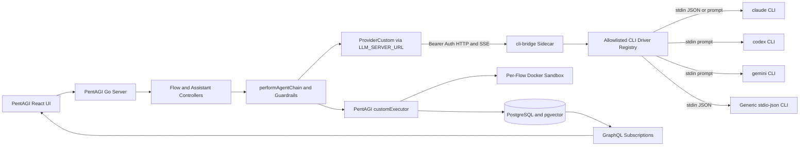

# CLI Agent Bridge Integration Proposal

## Status

This proposal specifies an opt-in, T3-Code-inspired multi-CLI agent bridge (`cli-bridge`) that lets PentAGI route flow and assistant reasoning turns to external LLM CLI harnesses (`claude`, `codex`, `gemini`, or any generic JSON-stdio CLI driver) while preserving 100% of PentAGI's execution rules, persistence guarantees, sandbox isolation, and source-code boundaries.

## Motivation

Operators increasingly run local or subscription-backed AI CLI harnesses alongside API-key providers. Re-implementing each CLI's subprocess lifecycle inside PentAGI's core Go provider registry would require PostgreSQL `PROVIDER_TYPE` enum migrations, sqlc/gqlgen/Swagger/GraphQL codegen churn, exhaustive frontend icon/label updates, and host-process execution inside the API container.

By contrast, PentAGI already ships an OpenAI-compatible `custom` provider ([`backend/pkg/providers/custom/custom.go`](../../backend/pkg/providers/custom/custom.go)) that discovers models via `GET /v1/models`, invokes chat completions with tool definitions (`POST /v1/chat/completions`), supports SSE streaming for live assistant output, and wires every call through `provider.WrapGenerate*`. A dedicated sidecar bridge implementing that exact wire contract lets PentAGI's unmodified core engine drive external CLIs under identical rules.

## Product Invariants

1. **Zero PentAGI core regression.** Existing Go backend packages, PostgreSQL schemas, GraphQL contracts, frontend routes, and tests remain unchanged on `main`.
2. **All execution stays under PentAGI rules.** The external CLI acts strictly as the reasoning and tool-call planning engine. Built-in host tools on external CLIs are disabled (`--tools ""` for Claude, `--sandbox read-only` for Codex, prompt-only JSON mode for Gemini) so every command, browser, search, file, and memory operation still executes through PentAGI's [`customExecutor`](../../backend/pkg/tools/executor.go) inside the per-flow Docker sandbox.
3. **Full PentAGI controller invariants preserved.** Because calls flow through `ProviderCustom` inside `flowProvider.performAgentChain` ([`backend/pkg/providers/performer.go`](../../backend/pkg/providers/performer.go)), PentAGI automatically enforces sequential subtask execution, PostgreSQL persistence before GraphQL subscription publish, repeating tool-call detection, execution monitor limits, `EnsureChainConsistency`, and `Config.GetSecretPatterns` secret redaction.
4. **Explicit opt-in and allowlist.** No CLI driver is enabled by default. An operator must explicitly list allowed drivers in `CLI_BRIDGE_ENABLED_DRIVERS` and supply a non-empty `CLI_BRIDGE_API_KEY`.
5. **No shell interpolation.** Drivers invoke binaries strictly via `spawn(binary, argv, { shell: false })` with fixed, driver-owned flags. User or model text is passed only via stdin or a dedicated prompt argument, never through a shell.
6. **Cancellation propagates end-to-end.** When an operator clicks Stop in PentAGI, the cancelled Go `context.Context` closes the HTTP request; `cli-bridge` immediately aborts the child process (`SIGTERM`, followed by `SIGKILL` after a bounded grace window) so no orphan CLI subprocess lingers.
7. **Bounded resources and secret redaction.** Every invocation enforces a hard timeout, maximum stdout/stderr byte cap, concurrency semaphore, and verbatim secret scrubbing across logs and error envelopes.

## Architecture

## Wire Protocol Contract

The bridge implements the exact OpenAI-compatible subset consumed by `langchaingo/llms/openai` and verified in [`frontend/e2e/mock-llm/server.mjs`](../../frontend/e2e/mock-llm/server.mjs):

| Endpoint | Behavior |
| --- | --- |
| `GET /healthz` | Unauthenticated liveness check returning enabled/available driver counts without leaking credentials or command lines |
| `GET /v1/models` | Authenticated model list returning `<driver>/<model>` entries only for drivers present in `CLI_BRIDGE_ENABLED_DRIVERS` |
| `POST /v1/chat/completions` | Authenticated completion supporting both plain JSON and `stream: true` SSE frames (`chat.completion.chunk` + `data: [DONE]`) |

### Tool Calling and PentAGI Compatibility

- **Fixed-width tool-call IDs.** PentAGI calls `GetToolCallIDTemplate` at flow/assistant creation to infer an ID format (`call_000001`). The bridge always emits deterministic 6-digit zero-padded IDs (`call_000001`, `call_000002`, ...) so `cast.NewChainAST` and `EnsureChainConsistency` stay deterministic across turns and provider switches.
- **Barrier tool preservation.** When `tools` are supplied in the OpenAI request (such as PentAGI's `done`, `ask`, `subtask_list`, `subtask_patch`, `terminal`, `file`, `browser`, `web_search`), the protocol serializer embeds the exact tool JSON schemas and instructs the CLI to respond with a strict JSON envelope: `{"content": "...", "tool_calls": [{"name": "...", "arguments": {...}}]}`.
- **Safe parsing and fallback.** The extractor handles raw JSON, Markdown-fenced JSON, single or multiple tool calls, validates that each returned tool name exists in the request's `tools` list when tools are provided, stringifies `arguments` to valid JSON strings for OpenAI wire compatibility, and falls back to plain assistant text when no tool call is requested (matching PentAGI's assistant completion semantics).
- **OpenAI error envelope.** Every non-2xx response returns `{"error": {"message": "...", "type": "...", "param": null, "code": "..."}}` because `langchaingo` reads `error.message` and drops bare error strings.

## Driver Registry

Inspired by T3 Code's multi-CLI driver abstraction, each driver implements a narrow contract:

| Driver ID | Model prefix | Default binary | Read-only / no-host-tools invocation |
| --- | --- | --- | --- |
| `claude` | `claude/<model>` | `claude` | `claude -p --output-format json --tools "" --no-session-persistence --model <model>` |
| `codex` | `codex/<model>` | `codex` | `codex exec --sandbox read-only --json --model <model> -` |
| `gemini` | `gemini/<model>` | `gemini` | `gemini -p "" --output-format json --model <model>` (prompt on stdin) |
| `stdio-json` | `stdio-json/<model>` | Configured via `CLI_BRIDGE_STDIO_JSON_BIN` | Stdin JSON `{model, prompt, messages, tools}` → stdout JSON `{content, tool_calls, usage}` |

Model routing resolves `<driver>/<model>` to the matching allowlisted driver. Unprefixed model names fall back to `CLI_BRIDGE_DEFAULT_DRIVER` only if that driver is explicitly enabled.

## Security and Operational Boundaries

- **Authentication:** Every `/v1/*` request requires `Authorization: Bearer <CLI_BRIDGE_API_KEY>` verified with constant-time comparison (`crypto.timingSafeEqual`).
- **Process isolation:** `cli-bridge` runs as a non-root user in its own sidecar container, never mounts `/var/run/docker.sock`, and never accesses PentAGI's PostgreSQL database directly.
- **Secret redaction:** `CLI_BRIDGE_API_KEY` and any extra patterns listed in `CLI_BRIDGE_REDACT_VALUES` are scrubbed verbatim before writing logs or returning error payloads.
- **Failure isolation:** Subprocess crashes, timeouts, malformed JSON, and oversized outputs return typed `502`/`504` OpenAI error envelopes so PentAGI's `callWithRetries` and `performCallerReflector` handle them cleanly without crashing the flow controller.

## Delivery Plan

1. **PR A (this RFC):** Document the architecture, invariants, wire contract, and driver security boundaries.
2. **PR B (`cli-bridge/`):** Implement the zero-dependency Node 24 multi-CLI bridge service, drivers, Dockerfile, and comprehensive offline `node --test` suite using fake CLI executables.
3. **PR C (Workshop & Compose Overlay):** Add `docker-compose.workshop.yml`, `docker-compose-cli-bridge.yml`, `examples/configs/cli-bridge.provider.yml`, `.env.workshop.example`, and operator documentation so a second isolated stack runs beside a live PentAGI installation with zero port, volume, network, or tenant collisions.
